<div align="center">

# Black Hole

**A Schwarzschild black hole simulated from scratch in C++ and SFML 3, one small program at a time.**

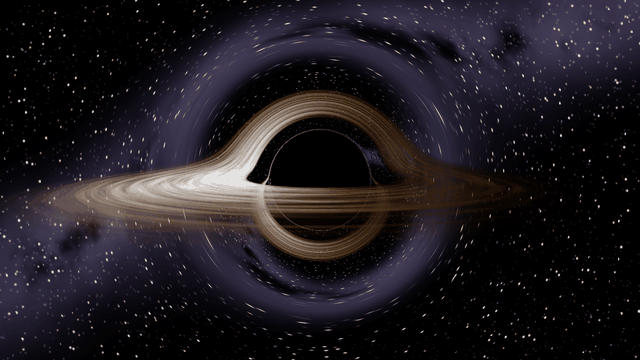


[The steps](#the-steps) ·
[How a pixel becomes a black hole](#how-a-pixel-becomes-a-black-hole) ·
[Checking the original physics](#checking-the-original-physics) ·
[Build and run](#build-and-run)

</div>

---

I watched Kavan's video [*Simulating Black Holes in C++*](https://github.com/kavan010/black_hole),
where he builds a black hole simulation with C++ and OpenGL, and wanted to really understand
how it works. So I rebuilt it in **SFML**, one step at a time, checking the physics against the
textbook as I went. That turned up a couple of bugs in the original shader, so this version
also gets the size of the black hole's shadow right.

Every step is its own program in [`steps/`](steps). Run them in order, or diff one against the
next to see exactly what changed.

## The steps

| | Step | What's new |
|:---:|---|---|
| 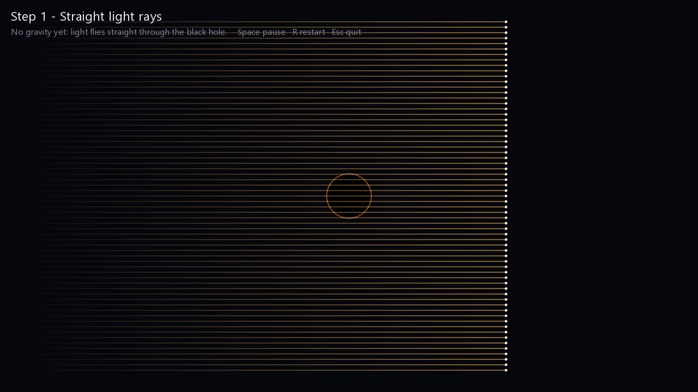 | **[1. Straight rays](steps/01_straight_rays/main.cpp)**<br>Light flies straight through the black hole. | Window, main loop, trails drawn with `sf::VertexArray` |
| 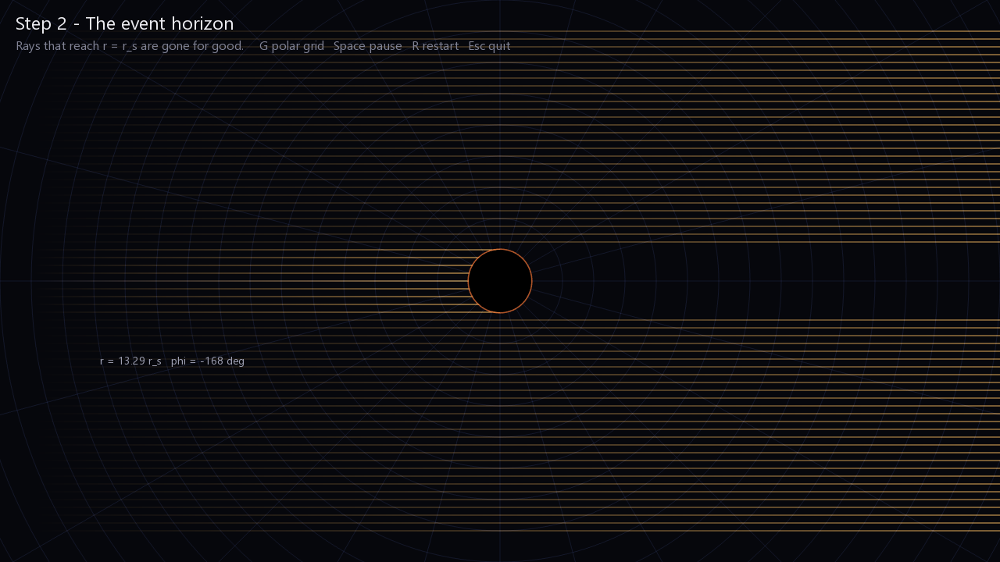 | **[2. Event horizon](steps/02_event_horizon/main.cpp)**<br>Rays that reach r = r_s are gone. | Polar coordinates (r, φ), hover to read them |
| 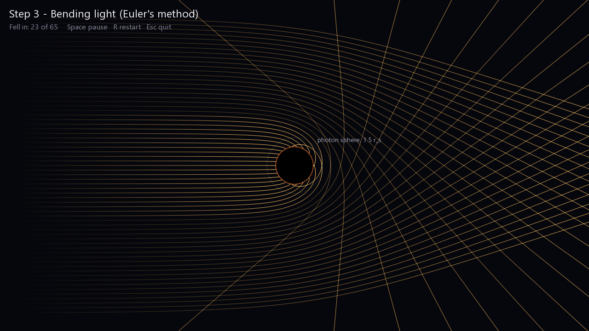 | **[3. Bending light](steps/03_bending_light/main.cpp)**<br>Gravity curves every ray. | Schwarzschild geodesic equations, Euler's method |
| 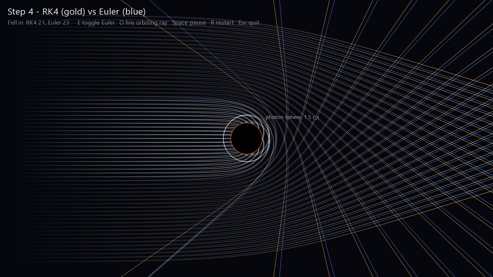 | **[4. RK4](steps/04_rk4/main.cpp)**<br>Gold = RK4, blue = Euler, white = a ray caught on the photon sphere. | Runge-Kutta 4, the photon sphere |
| 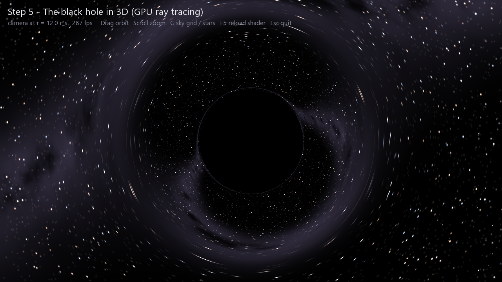 | **[5. 3D on the GPU](steps/05_shadow_3d)**<br>One light ray per pixel, 921,600 of them every frame. | Fragment shader ray tracer, orbit camera, starfield |
| 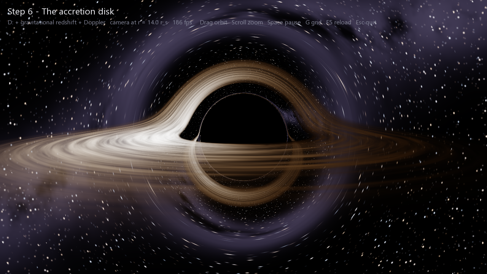 | **[6. Accretion disk](steps/06_accretion_disk)**<br>Hot gas orbiting at up to half the speed of light. | Thin-disk temperatures, Doppler shift, gravitational redshift |

### Roadmap

- [x] 1-4: light bending in 2D
- [x] 5: 3D black hole on the GPU
- [x] 6: accretion disk
- [ ] 7: stars and planets as real objects
- [ ] 8: objects moving under gravity
- [ ] 9: the curved-space grid
- [ ] 10: everything together, polished

<details>
<summary><b>Step 1-2: rays, trails and polar coordinates</b></summary>

<br>

Each ray is a point moving at the speed of light (1, in these units) with a trail behind it. The
trail is one `LineStrip` whose alpha fades from the tail to the head, drawn with additive
blending so overlapping light glows.

Step 2 gives every ray its position relative to the black hole in polar coordinates:

$$r = \sqrt{x^2 + y^2}, \qquad \phi = \operatorname{atan2}(y, x)$$

Once $r \le r_s$ the ray has crossed the event horizon and stops. Turn on the grid (G) and move
the mouse around to read r and φ anywhere.

</details>

<details>
<summary><b>Step 3: the geodesic equations</b></summary>

<br>

Light follows a *null geodesic*: the straightest possible path through curved spacetime. For a
ray moving in a plane around a non-spinning black hole, with $f = 1 - r_s/r$:

$$\frac{d^2 r}{d\lambda^2} = -\frac{r_s}{2r^2}\, f \left(\frac{dt}{d\lambda}\right)^2 + \frac{r_s}{2r^2 f}\left(\frac{dr}{d\lambda}\right)^2 + (r - r_s)\left(\frac{d\phi}{d\lambda}\right)^2$$

$$\frac{d^2 \phi}{d\lambda^2} = -\frac{2}{r}\,\frac{dr}{d\lambda}\,\frac{d\phi}{d\lambda}$$

The three terms in the first line are gravity pulling the ray in, a correction for moving along
r, and sideways motion pushing it out. `dt/dλ = E/f` comes from the ray's energy E, which is set
once at the start by the null condition $ds^2 = 0$.

Euler's method then moves the ray: velocity += acceleration · step, position += velocity · step.

</details>

<details>
<summary><b>Step 4: why RK4 beats Euler</b></summary>

<br>

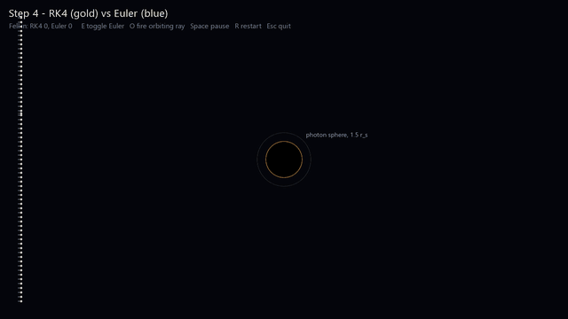

Euler follows the slope at the start of each step, so on a curve it cuts corners. RK4 samples the
slope four times (start, two midpoints, end) and averages them 1-2-2-1.

You can count the difference. Rays that pass closer than $b = \tfrac{3\sqrt3}{2} r_s \approx 2.6\,r_s$
fall in, which is 21 of the 65 rays here. RK4 catches exactly 21. Euler catches 23: its error pulls in
two rays that should escape.

The white ray starts $10^{-9}\,r_s$ outside that critical distance. It circles the photon sphere
(1.5 $r_s$) about 3.3 times before escaping.

</details>

<details>
<summary><b>Step 5: the same physics, but in 3D on the GPU</b></summary>

<br>

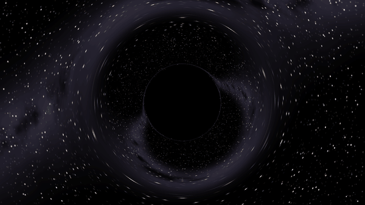

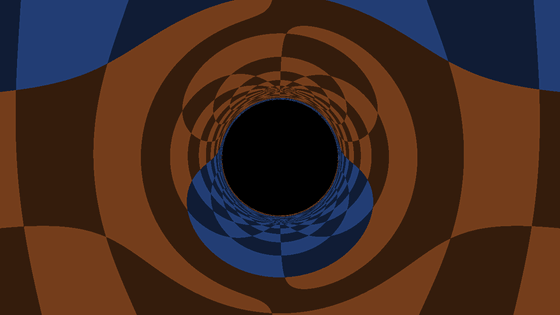

Tracing 921,600 rays every frame is too much for a CPU, so it runs in a fragment shader:
[`blackhole.frag`](steps/05_shadow_3d/blackhole.frag), a small program the GPU runs once per pixel.

The shader bends rays with a simple pull towards the centre:

$$\ddot{\mathbf{x}} = -\frac{3}{2}\, r_s\, \frac{h^2}{r^5}\, \mathbf{x}, \qquad h = |\mathbf{x} \times \dot{\mathbf{x}}| \text{ (constant)}$$

This isn't an approximation. Put the null condition into step 3's r equation and it becomes
$\ddot r = (r - \tfrac32 r_s)\,\dot\phi^2$, and this pull gives exactly the same equation. The paths are
identical, but there's no trig, no special axis, and nothing blows up at the horizon.

The checkerboard (G) shows what the black hole does to the view behind it: the Einstein ring, the
sky above showing up below the shadow, and thinner and thinner rings from light that went around
the hole more than once.

</details>

<details>
<summary><b>Step 6: why one side of the disk is brighter</b></summary>

<br>

The disk is a thin sheet of gas in the y = 0 plane, from 3 $r_s$ to 12 $r_s$. 3 $r_s$ is the innermost
stable circular orbit: closer in, gas can't stay in orbit and plunges into the hole. After every RK4 step
the ray checks whether it crossed the plane, and if so it picks up the light given off there.

**Temperature.** In the standard thin-disk model the gas is hottest a little outside the inner edge
(about 4.1 $r_s$) and cools further out:

$$T(r) \propto r^{-3/4}\left(1 - \sqrt{r_\text{in}/r}\right)^{1/4}$$

**Shift.** What the camera sees differs from what the gas sends out by one factor:

$$g = \frac{\nu_\text{seen}}{\nu_\text{sent}} = \frac{1}{\sqrt{1 - r_s/r_\text{cam}}\;\, u^t\,(1 - \Omega\,\ell)}, \qquad u^t = \frac{1}{\sqrt{1 - \tfrac32 r_s/r}}, \qquad \Omega = \sqrt{\frac{r_s}{2r^3}}$$

$u^t$ is how slowly the orbiting gas's clock runs (gravity plus its own speed), $\Omega$ is its orbital
speed, and $\ell$ is the photon's angular momentum per unit energy, which stays the same along the whole
ray. A blackbody at temperature $T$ seen with shift $g$ looks like a blackbody at $gT$, and its brightness
goes as $T^4$, so as $g^4$ in all. Press **D** to switch the effects on one at a time:

| Plain colours | + gravitational redshift | + Doppler |
|:---:|:---:|:---:|
| 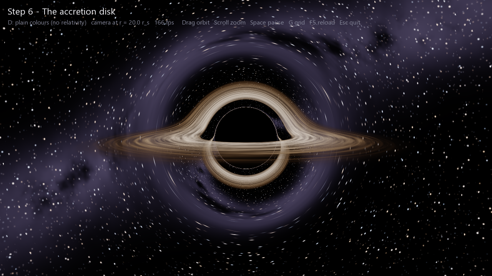 | 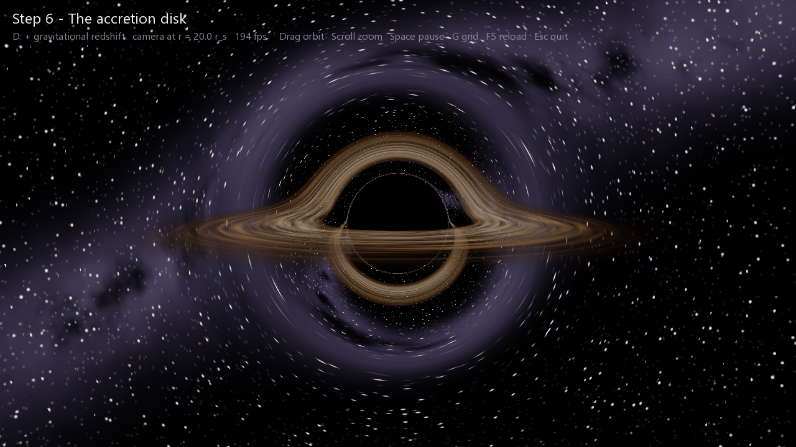 | 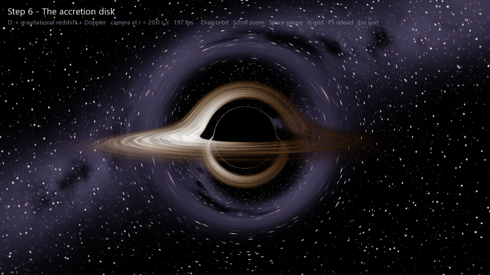 |
| no relativity | light loses energy climbing out | gas coming towards us is ~7× brighter |

The disk's far side shows up bent over the top of the shadow, and its underside wraps round below. The
temperature scale (4500 K at the peak) is picked so it looks good on screen. The shape of the profile and
the shift are physical.

</details>

## How a pixel becomes a black hole

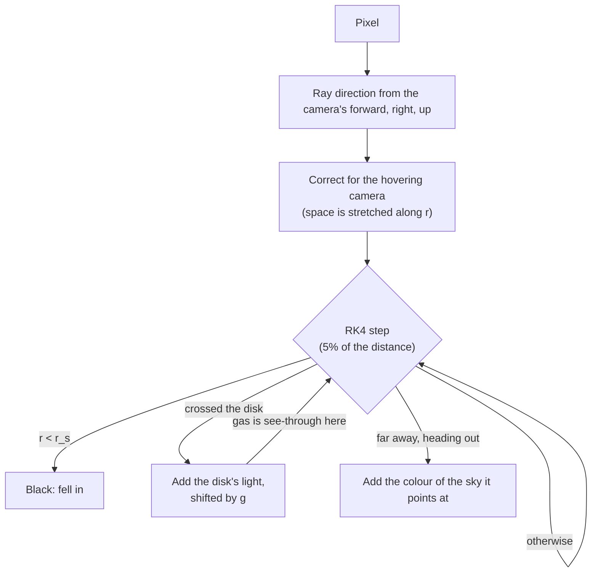

Steps are 5% of the current distance from the hole: big far away, tiny near the photon sphere. A ray
takes a few hundred steps instead of a fixed 60,000.

## Checking the original physics

[`checks/shadow_check.cpp`](checks/shadow_check.cpp) traces rays from 5 $r_s$ using the equations in the
original `geodesic.comp`, and using the textbook ones, then finds the edge of the shadow:

| Equations | Shadow edge | Shadow height vs screen |
|---|---:|---:|
| Textbook (matches the exact formula) | 30.41° | 102% |
| Only the energy mistake | 28.45° | 94% |
| Only the r-equation mistake | 20.36° | 64% |
| **Original shader** | **18.74°** | **59%** |

Two things are different in the original:

- **The r equation uses `r` where the textbook has `(r - r_s)`.** That removes the photon sphere: light
  skimming past is always pushed back out, so it bends less.
- **The photon's energy is missing a `/f`** under the square root, which weakens gravity a bit more.

Together they make the shadow about 40% too small. The original also calls its integrator `rk4Step`,
but it takes a single Euler step.

The 3D version here measures 132.0 px for the shadow's radius from 12 $r_s$ (theory: 132.1 px) and 327.0 px
from 5 $r_s$ (theory: 327.3 px).

## Performance

| | Original | This version |
|---|---|---|
| Resolution | 200 × 150 (30,000 rays) | 1280 × 720 (921,600 rays) |
| Steps per ray | fixed 60,000 | a few hundred, adaptive |
| Frame rate | not measured | 206-244 fps (RTX 4060 Laptop), with the disk too |

On a laptop with two GPUs, Windows puts OpenGL programs on the slow built-in chip by default (about
12 fps here). [`use_fast_gpu.cpp`](steps/common/use_fast_gpu.cpp) asks the driver for the dedicated one.

## Build and run

You need a C++17 compiler, SFML 3, CMake and Ninja. On Windows with [MSYS2](https://www.msys2.org) (UCRT64):

```bash
pacman -S --needed mingw-w64-ucrt-x86_64-sfml mingw-w64-ucrt-x86_64-cmake mingw-w64-ucrt-x86_64-ninja
```

```bash
cmake -S . -B build -G Ninja
cmake --build build
build/05_shadow_3d.exe
```

| Step | Controls |
|---|---|
| All 2D steps | **Space** pause · **R** restart · **Esc** quit |
| 2 | **G** polar grid · hover to read r and φ |
| 4 | **E** show/hide Euler · **O** fire the orbiting ray |
| 5 | **Drag** orbit · **Scroll** zoom · **G** checkerboard / stars · **F5** reload the shader |
| 6 | Same as 5, plus **D** colour mode · **Space** pause the disk |

Editing a step's `blackhole.frag` doesn't need a rebuild: change something and press F5.

<details>
<summary><b>Screenshots, recordings and GIFs</b></summary>

<br>

Every step can save frames instead of running interactively:

```bash
build/04_rk4.exe --shot step4.png --frame 420          # one screenshot
build/05_shadow_3d.exe --stars --spin --clean --record build/frames/hero --frame 360 --every 3
python tools/make_gif.py build/frames/hero hero.gif --width 600 --fps 14 --skip 2 --no-dither
```

`--clean` hides the captions, `--spin` makes the 3D camera orbit by itself, and `--distance D`
starts it D Schwarzschild radii away. Step 6 also takes `--mode 0|1|2` and `--grid`.

</details>

## Project layout

```
steps/
  common/            window, captions, screenshots, GPU selection (shared by every step)
  01_straight_rays/  ... 06_accretion_disk/    one program per step
checks/
  shadow_check.cpp   original shader physics vs the textbook
tools/
  make_gif.py        recorded frames -> GIF
docs/                screenshots and GIFs for this page
```

## Units

Everything uses units where the Schwarzschild radius $r_s = 1$ and the speed of light $c = 1$. For
Sagittarius A*, $r_s$ is about 12.7 million km, so the camera's default distance of 12 $r_s$ is roughly
150 million km: about the distance from the Earth to the Sun.

## Credits

Based on Kavan's video *Simulating Black Holes in C++* and his code at
[kavan010/black_hole](https://github.com/kavan010/black_hole). The physics is the Schwarzschild solution of
general relativity. Built with [SFML](https://www.sfml-dev.org).
